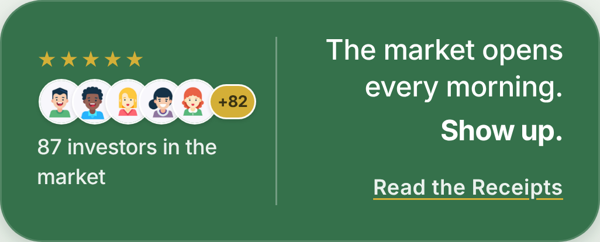
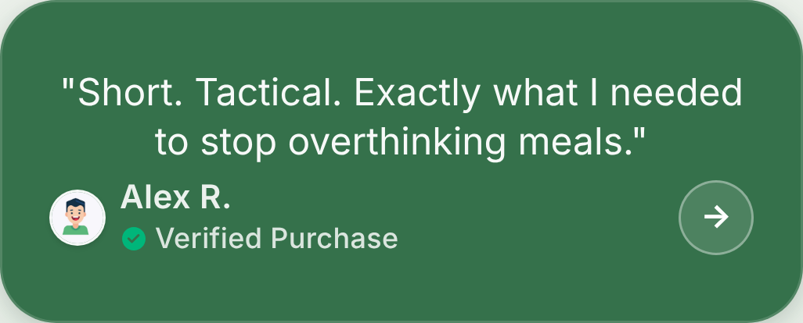

# Reader bar: design snapshot

The green bar under What's Inside, as it ran on nutritioninvested.com until 20 October 2026: five stars, a stack of reader avatars, a count of "investors in the market", the tagline, and a "Read the Receipts" panel of reader quotes.

> **Placeholder content.** The six quotes, the names, the cartoon avatars, the five stars, the "Verified Purchase" marks and the 87 count are design stand-ins, not real readers or sales. The bar goes back on the live site only with real quotes from readers who agreed to be shown, the real count, and no "Verified Purchase" unless each buyer was checked.

## Where it lives

- **Branch `reader-bar-design`**: `main` at commit `c382051`, plus this folder. Its `index.html` and `pic1.jpg` to `pic6.jpg` are the working snapshot.
- **Removed from `main`** in commit `d0b331b` ("Take the placeholder reader bar off the live page"). `main` now runs a tagline-only bar, shown at the end of this file.

## Bringing it back

1. Gather the real material: quotes with each reader's permission, a photo for each, and the true count.
2. Ask Claude: "Restore the reader bar from the `reader-bar-design` branch using `design/reader-bar/README.md`, with these quotes: ..."
3. Claude restores it onto the current `main`:
   - **If nothing near the bar has changed since `d0b331b`:** `git revert d0b331b` brings back every line and all six photos exactly.
   - **Otherwise:** re-apply the HTML, CSS and JavaScript below in place of the tagline-only bar, and copy `pic1.jpg` to `pic6.jpg` from this branch.
4. Swap the placeholder data for the real material (the `readerQuotes` array, `data-target`, the avatar and quote photos), drop "Verified Purchase" unless verified, compare against the screenshots, and preview before pushing.

## What it looks like

| Default (phone, 3x) | Read the Receipts open |
|---|---|
|  |  |

In context: [phone, 390 x 844](phone-page.png) and [desktop, 1280 x 800](desktop-page.png), captured after the count finished.

## Anatomy

- **Container** `footer#counter-bar.counter-bar`: green rounded bar under the What's Inside card. Max width 448px, 520px from 768px wide, 560px from 1024px wide (those two width rules still exist on `main`).
- **Left column** `.counter-bar-left`, 126px wide and at least 104px tall: five gold stars; an avatar stack of five 26px circles (`pic1` to `pic5`) overlapping by 7px, then a gold `+N` chip; the count line "87 investors in the market".
- **Divider**: 1px white line at 30% opacity.
- **Right column, default panel**: the tagline right-aligned ("The market opens every morning." / **"Show up."**), with the "Read the Receipts" text button below it, underlined in gold.
- **Right column, quote panel**: slides in from the right over the default panel. The quote in straight double quotes, clamped to three lines; a 24px round photo; the name; a green check with "Verified Purchase"; a round arrow button.
- **Height**: the bar's height comes from the left column. Both right-hand panels are absolutely positioned over it, so the left column can't be dropped on its own without the bar collapsing.

## Behavior

- **Count-up**: on moving to What's Inside, after 480 ms the chip and the count line animate from the five shown avatars up to the target over 1,800 ms (ease-out cubic). Going back to the first page resets them, so it runs again on the next visit.
- **Target**: `data-target="87"` on `.counter-avatar-stack`. The chip shows the target minus the number of avatar images (87 minus 5 = +82).
- **Number format**: 1,000 and up shows as 1K, 1.2K, 12K; a million and up as 1.2M, 12M.
- **Read the Receipts** opens the quote panel at the first quote. The arrow steps through the quotes and closes the panel after the last one.
- **Photos** load from `data-reader-file` names (`pic1` becomes `./pic1.jpg`).

## Content (placeholder)

| # | Quote | Name | Photo |
|---|---|---|---|
| 1 | Short. Tactical. Exactly what I needed to stop overthinking meals. | Alex R. | pic1 |
| 2 | I used the plate framework for one week and felt in control again. | Jordan T. | pic2 |
| 3 | Simple language, clear actions, no fluff. I reread it every Sunday. | Maya L. | pic3 |
| 4 | The recovery section kept me from quitting after a rough travel week. | Chris D. | pic4 |
| 5 | I finally understand what to track and what to ignore. | Nina S. | pic5 |
| 6 | It feels like having a coach in my pocket, minus the complexity. | Evan P. | pic6 |

## Assets

| File | Pixels | Size | Used for |
|---|---|---|---|
| pic1.jpg | 747 x 770 | 27 KB | avatar 1, quote 1 |
| pic2.jpg | 679 x 777 | 27 KB | avatar 2, quote 2 |
| pic3.jpg | 818 x 760 | 26 KB | avatar 3, quote 3 |
| pic4.jpg | 706 x 745 | 29 KB | avatar 4, quote 4 |
| pic5.jpg | 747 x 758 | 28 KB | avatar 5, quote 5 |
| pic6.jpg | 781 x 754 | 27 KB | quote 6 only |

## Design tokens

From `:root` in the snapshot. `--color-verified` was removed from `main`; the rest are still there.

```css
--color-accent: #35714B;
--color-bar-bg: var(--color-accent);
--color-gold: #D4AF37;
--color-verified: #00B67A;
--color-white: #ffffff;
--radius-lg: 24px;
--radius-pill: 980px;
--shadow-primary: 0 8px 32px rgba(var(--accent-rgb), 0.25), 0 2px 8px rgba(0,0,0,0.1);
--sp-2: 16px;
--text-body: clamp(1rem, 3.8vw, 1.0625rem);
--text-caption: clamp(0.75rem, 2.8vw, 0.8125rem);
--text-label: clamp(0.875rem, 3.2vw, 0.9375rem);
--timing-spring: 0.22s cubic-bezier(0.32, 0.72, 0, 1);
--track-normal: -0.011em;
--track-tight: -0.022em;
```

## Code, verbatim from the snapshot

### HTML

```html
      <footer id="counter-bar" class="counter-bar">
        <div class="counter-bar-left">
          <div class="counter-bar-stars" aria-hidden="true">★★★★★</div>
          <div class="counter-avatar-stack" data-target="87" aria-label="87 investors">
            
            
            
            
            
            <span class="counter-avatar-overflow" id="counter-overflow" aria-hidden="true"></span>
          </div>
          <span id="counter-count-text" class="counter-bar-count">87 investors in the market</span>
        </div>
        <div class="counter-bar-divider" aria-hidden="true"></div>
        <div id="counter-bar-right" class="counter-bar-right">
          <div class="counter-right-panel counter-right-default">
            <span class="counter-bar-tagline">
              <span class="tagline-setup">The market opens every morning.</span>
              <span class="tagline-punch">Show up.</span>
            </span>
            <button id="read-receipts" class="counter-receipts-link" type="button">Read the Receipts</button>
          </div>
        </div>
        <div class="counter-right-panel counter-right-quote" aria-live="polite">
          <p id="reader-quote-text" class="counter-quote-text"></p>
          <div class="counter-quote-footer">
            <div class="counter-quote-meta">
              
              <div class="counter-quote-meta-text">
                <span id="reader-quote-name" class="counter-quote-name"></span>
                <span id="reader-quote-handle" class="counter-quote-verified">
                  <svg xmlns="http://www.w3.org/2000/svg" width="12" height="12" viewBox="0 0 24 24" fill="var(--color-verified)" aria-hidden="true">
                    <path d="M12 2C6.477 2 2 6.477 2 12s4.477 10 10 10 10-4.477 10-10S17.523 2 12 2zm4.707 7.707-5.657 5.657a1 1 0 0 1-1.414 0l-2.829-2.828a1 1 0 0 1 1.414-1.414L10.293 13.293l4.95-4.95a1 1 0 0 1 1.414 1.414z"/>
                  </svg>
                  Verified Purchase
                </span>
              </div>
            </div>
            <button id="reader-quote-next" class="counter-quote-nav" type="button" aria-label="Next reader quote">→</button>
          </div>
        </div>
      </footer>
```

### CSS

The bar block:

```css
    .counter-bar {
      width: 100%; max-width: 448px; flex-shrink: 0; background: var(--color-bar-bg); border-radius: var(--radius-lg);
      border: 1px solid rgba(255, 255, 255, 0.15); box-shadow: var(--shadow-primary); padding: var(--sp-2) 20px;
      display: flex; align-items: stretch; justify-content: space-between; gap: 10px; z-index: 100;
      position: relative; overflow: hidden;
    }
    .counter-bar-left { display: flex; flex-direction: column; gap: 5px; flex: none; width: 126px; min-height: 104px; justify-content: center; }
    .counter-bar-stars { color: var(--color-gold); font-size: 0.6875rem; letter-spacing: 1px; line-height: 1; }
    .counter-bar-count { font-size: var(--text-caption); font-weight: 500; color: rgba(255,255,255,0.9); line-height: 1.35; letter-spacing: var(--track-normal); }
    .counter-avatar-stack { display: flex; align-items: center; padding-left: 1px; min-height: 26px; }
    .counter-avatar {
      width: 26px; height: 26px; border-radius: 50%; object-fit: cover; border: 1.5px solid rgba(255,255,255,0.95);
      box-shadow: 0 1px 2px rgba(0,0,0,0.12); display: block; background: rgba(255,255,255,0.2); flex-shrink: 0;
    }
    .counter-avatar + .counter-avatar { margin-left: -7px; }
    .counter-avatar-overflow {
      min-width: 20px; width: auto; height: 20px; border-radius: var(--radius-pill); border: 1.5px solid rgba(255,255,255,0.95);
      box-shadow: 0 1px 2px rgba(0,0,0,0.12); background: var(--color-gold);
      display: inline-flex; align-items: center; justify-content: center;
      font-size: 9px; font-weight: 700; color: #3A3313; letter-spacing: -0.02em;
      flex-shrink: 0; margin-left: -5px; padding: 0 4px;
    }
    .counter-bar-divider { width: 1px; background: rgba(255,255,255,0.3); flex-shrink: 0; align-self: stretch; margin: 4px 0; }
    .counter-bar-right { flex: 1; min-width: 0; position: relative; overflow: hidden; text-align: right; }
    .counter-right-panel {
      position: absolute; top: 0; left: 0; right: 0; bottom: 0;
      display: flex; flex-direction: column; align-items: flex-end; justify-content: space-between;
      transition: transform var(--timing-spring), opacity 0.2s ease; will-change: transform, opacity;
    }
    .counter-right-default { transform: translateX(0); opacity: 1; justify-content: center; gap: 14px; padding: 1px 0 7px; transition: opacity 0.2s ease; }
    .counter-right-quote {
      background: var(--color-bar-bg); border-radius: var(--radius-lg); padding: 12px 20px;
      align-items: center; justify-content: center; gap: 6px;
      transform: translateX(110%); opacity: 0; pointer-events: none; z-index: 10;
    }
    .counter-bar.show-quote .counter-right-default { opacity: 0; pointer-events: none; }
    .counter-bar.show-quote .counter-right-quote { transform: translateX(0); opacity: 1; pointer-events: auto; }
    .counter-bar-tagline { text-align: right; color: var(--color-white); }
    .tagline-setup {
      display: block; font-size: var(--text-body); font-weight: 500;
      line-height: 1.3; letter-spacing: var(--track-normal);
      margin-bottom: 4px; text-wrap: balance;
    }
    .tagline-punch {
      display: block;
      font-size: var(--text-body); font-weight: 700;
      line-height: 1.3; letter-spacing: var(--track-tight);
      color: var(--color-white);
    }
    .counter-receipts-link {
      appearance: none; border: 0; background: none; color: rgba(255,255,255,0.9); font: inherit; font-size: var(--text-caption);
      font-weight: 600; letter-spacing: 0.02em; text-decoration: underline; text-decoration-color: var(--color-gold); text-underline-offset: 2px; padding: 0; cursor: pointer; transition: opacity 0.2s ease, transform var(--timing-spring);
      position: relative;
    }
    .counter-receipts-link::after { content: ''; position: absolute; inset: -13px -8px; }
    .counter-receipts-link:active { opacity: 0.8; transform: scale(0.97); }
    .counter-quote-text { font-size: var(--text-body); line-height: 1.3; color: rgba(255,255,255,0.96); text-align: center; width: 100%; overflow-wrap: anywhere; display: -webkit-box; -webkit-line-clamp: 3; -webkit-box-orient: vertical; overflow: hidden; }
    .counter-quote-footer { display: flex; align-items: center; justify-content: space-between; width: 100%; }
    .counter-quote-meta { display: inline-flex; align-items: center; gap: 6px; }
    .counter-quote-meta-text { display: flex; flex-direction: column; gap: 1px; }
    .counter-quote-photo { width: 24px; height: 24px; border-radius: 50%; object-fit: cover; border: 1.5px solid rgba(255,255,255,0.95); box-shadow: 0 1px 2px rgba(0,0,0,0.12); background: rgba(255,255,255,0.2); display: block; }
    .counter-quote-name { font-size: var(--text-label); font-weight: 600; color: rgba(255,255,255,0.9); letter-spacing: 0.01em; }
    .counter-quote-verified {
      display: inline-flex; align-items: center; gap: 3px;
      font-size: var(--text-caption); font-weight: 500; color: rgba(255,255,255,0.82); letter-spacing: 0.01em;
    }
    .counter-quote-verified svg { flex-shrink: 0; }
    .counter-quote-nav {
      appearance: none; border: 1px solid rgba(255,255,255,0.36); border-radius: 50%; background: rgba(255,255,255,0.12);
      color: var(--color-white); font: inherit; font-size: var(--text-label); font-weight: 700; line-height: 1;
      width: 32px; height: 32px; padding: 0; flex-shrink: 0; position: relative;
      display: inline-flex; align-items: center; justify-content: center; cursor: pointer; transition: background 0.2s ease, transform var(--timing-spring);
    }
    .counter-quote-nav::after { content: ''; position: absolute; inset: -6px; }
    .counter-quote-nav:active { background: rgba(255,255,255,0.22); transform: scale(0.93); }
    .counter-bar :focus-visible { outline-color: rgba(255,255,255,0.92); }
```

Hover rules, inside `@media (hover: hover) and (pointer: fine)`:

```css
      .counter-receipts-link:hover { opacity: 0.75; }
      .counter-quote-nav:hover { background: rgba(255,255,255,0.22); }
```

### JavaScript

All inside the `DOMContentLoaded` handler. Setup, placed after the `updateFades` wiring:

```js
    var avatarStackEl = document.querySelector('.counter-avatar-stack');
    var overflowEl = document.getElementById('counter-overflow');
    var counterTarget = avatarStackEl ? parseInt(avatarStackEl.getAttribute('data-target'), 10) : 0;
    var avatarCount = avatarStackEl ? avatarStackEl.querySelectorAll('.counter-avatar').length : 0;
    var animated = false;
    if (avatarStackEl && counterTarget > 0) {
      avatarStackEl.setAttribute('aria-label', counterTarget + ' investors');
    }
    if (overflowEl) {
      overflowEl.textContent = formatOverflow(counterTarget - avatarCount);
    }

    function readerAssetPath(fileName) {
      var ext = fileName.includes('.') ? '' : '.jpg';
      return './' + fileName + ext;
    }

    var counterBarEl = document.getElementById('counter-bar');
    var counterCountEl = document.getElementById('counter-count-text');
    if (counterCountEl) {
      counterCountEl.textContent = formatInvestorCount(counterTarget) + ' investors in the market';
    }
    var readReceiptsBtn = document.getElementById('read-receipts');
    var quoteTextEl = document.getElementById('reader-quote-text');
    var quoteNameEl = document.getElementById('reader-quote-name');
    var quotePhotoEl = document.getElementById('reader-quote-photo');
    var quoteNextBtn = document.getElementById('reader-quote-next');
    var quoteIndex = 0;
    var readerQuotes = [
      { quote: 'Short. Tactical. Exactly what I needed to stop overthinking meals.', name: 'Alex R.', photo: 'pic1' },
      { quote: 'I used the plate framework for one week and felt in control again.', name: 'Jordan T.', photo: 'pic2' },
      { quote: 'Simple language, clear actions, no fluff. I reread it every Sunday.', name: 'Maya L.', photo: 'pic3' },
      { quote: 'The recovery section kept me from quitting after a rough travel week.', name: 'Chris D.', photo: 'pic4' },
      { quote: 'I finally understand what to track and what to ignore.', name: 'Nina S.', photo: 'pic5' },
      { quote: 'It feels like having a coach in my pocket, minus the complexity.', name: 'Evan P.', photo: 'pic6' }
    ];

    function hydrateReaderImages() {
      var avatarEls = document.querySelectorAll('.counter-avatar[data-reader-file]');
      avatarEls.forEach(function (el) {
        var fileName = el.getAttribute('data-reader-file');
        if (!fileName) return;
        el.src = readerAssetPath(fileName);
      });
      if (quotePhotoEl) {
        var defaultFile = quotePhotoEl.getAttribute('data-reader-file');
        if (defaultFile) quotePhotoEl.src = readerAssetPath(defaultFile);
      }
    }

    function renderReaderQuote(index) {
      if (!quoteTextEl || !quoteNameEl || !quotePhotoEl || readerQuotes.length === 0) return;
      var item = readerQuotes[index % readerQuotes.length];
      quoteTextEl.textContent = '"' + item.quote + '"';
      quoteNameEl.textContent = item.name;
      quotePhotoEl.src = readerAssetPath(item.photo);
      quotePhotoEl.alt = item.name + ' photo';
    }

    function openReceipts() {
      if (!counterBarEl) return;
      quoteIndex = 0;
      renderReaderQuote(quoteIndex);
      counterBarEl.classList.add('show-quote');
    }

    function closeReceipts() {
      if (!counterBarEl) return;
      counterBarEl.classList.remove('show-quote');
    }

    if (readReceiptsBtn) { readReceiptsBtn.addEventListener('click', openReceipts); }
    if (quoteNextBtn) {
      quoteNextBtn.addEventListener('click', function () {
        if (quoteIndex >= readerQuotes.length - 1) {
          closeReceipts();
        } else {
          quoteIndex++;
          renderReaderQuote(quoteIndex);
        }
      });
    }

    hydrateReaderImages();
    renderReaderQuote(quoteIndex);
```

Number formatting and the count animation, placed after the menu handlers:

```js
    function formatOverflow(n) {
      if (n >= 1000000) {
        var m = n / 1000000;
        return '+' + (m >= 10 ? Math.floor(m) : Math.floor(m * 10) / 10) + 'M';
      }
      if (n >= 1000) {
        var k = n / 1000;
        return '+' + (k >= 10 ? Math.floor(k) : Math.floor(k * 10) / 10) + 'K';
      }
      return '+' + n;
    }

    function formatInvestorCount(n) {
      if (n >= 1000000) {
        var m = n / 1000000;
        return (m >= 10 ? Math.floor(m) : Math.floor(m * 10) / 10) + 'M';
      }
      if (n >= 1000) {
        var k = n / 1000;
        return (k >= 10 ? Math.floor(k) : Math.floor(k * 10) / 10) + 'K';
      }
      return String(n);
    }

    function animateCount(from, to, dur) {
      if (!overflowEl) return;
      var t0 = performance.now();
      function tick(now) {
        var p = Math.min((now - t0) / dur, 1);
        var ease = 1 - Math.pow(1 - p, 3);
        var current = Math.floor(from + (to - from) * ease);
        overflowEl.textContent = formatOverflow(current);
        if (counterCountEl) counterCountEl.textContent = formatInvestorCount(current + avatarCount) + ' investors in the market';
        if (p < 1) requestAnimationFrame(tick);
      }
      requestAnimationFrame(tick);
    }
```

Inside `goToPage(index)`, right after the slide transform is set:

```js
      if (index === 1 && !animated) {
        animated = true;
        setTimeout(function () {
          if (overflowEl) overflowEl.textContent = formatOverflow(0);
          if (counterCountEl) counterCountEl.textContent = formatInvestorCount(avatarCount) + ' investors in the market';
          animateCount(0, counterTarget - avatarCount, 1800);
        }, 480);
      }
      if (index === 0) {
        animated = false;
        if (overflowEl) overflowEl.textContent = formatOverflow(counterTarget - avatarCount);
        if (counterCountEl) counterCountEl.textContent = formatInvestorCount(counterTarget) + ' investors in the market';
      }
```

The snapshot also declares `var counterBar = document.getElementById('counter-bar');` near the top of the handler. Nothing reads it, and `main` dropped it.

## What `main` runs instead

```html
      <footer id="counter-bar" class="counter-bar">
        <p class="counter-bar-tagline">
          <span class="tagline-setup">The market opens every morning.</span>
          <span class="tagline-punch">Show up.</span>
        </p>
      </footer>
```

```css
    .counter-bar {
      width: 100%; max-width: 448px; flex-shrink: 0; background: var(--color-bar-bg); border-radius: var(--radius-lg);
      border: 1px solid rgba(255, 255, 255, 0.15); box-shadow: var(--shadow-primary); padding: var(--sp-2) 20px;
      display: flex; align-items: center; justify-content: center; z-index: 100;
      position: relative; overflow: hidden;
    }
    .counter-bar-tagline { margin: 0; padding: 10px 0; text-align: center; color: var(--color-white); }
```
